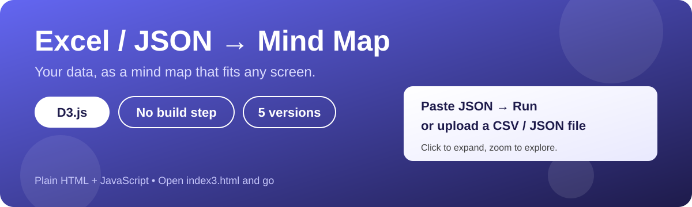
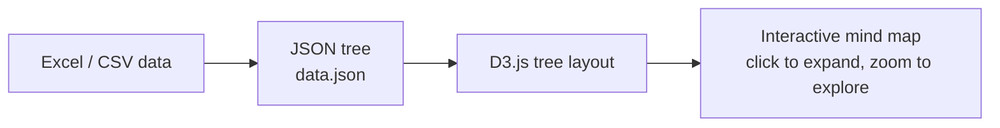

<p align="center">
  
</p>

<p align="center">
  <a href="https://github.com/smabdulmueid97/Excel-JSON-Data-to-fully-responsive-mind-map-Converter"></a>
  <a href="https://github.com/smabdulmueid97/Excel-JSON-Data-to-fully-responsive-mind-map-Converter"></a>
  <a href="https://github.com/smabdulmueid97/Excel-JSON-Data-to-fully-responsive-mind-map-Converter"></a>
  <a href="https://github.com/smabdulmueid97/Excel-JSON-Data-to-fully-responsive-mind-map-Converter/stargazers"></a>
</p>

<h1 align="center">Excel / JSON → Mind Map</h1>

<p align="center">
  Turn spreadsheet or JSON data into a <b>fully responsive, interactive mind map</b>.<br />
  Plain HTML + JavaScript with <b>D3.js</b> — no build step, no install.
</p>

<p align="center">
  <a href="#-quick-start">Quick start</a> •
  <a href="#-versions">Versions</a> •
  <a href="#-what-it-does">What it does</a> •
  <a href="#-layout">Layout</a>
</p>

---

## What it does



- **Collapsible nodes** — nodes start collapsed; click to expand one branch, its siblings collapse.
- **Zoom &amp; pan** — mouse-wheel zoom (0.5×–5× in v1) and drag to move around the map.
- **Paste or upload your data** (v3) — paste JSON into the sidebar, or upload a JSON or CSV file, then hit **Run**.
- **Export graph coordinates** (v3) — export the laid-out node positions from the sidebar.
- **Responsive** — the map sizes itself to the browser window.

## 🚀 Quick start

No install, no build. Serve the folder over HTTP (browsers block `d3.json` from `file://`):

```bash
python3 -m http.server 8000
# open http://localhost:8000/index.html
```

Or right-click `index3.html` → **Open with Live Server** (as the original `Readme.md` suggests).

## 🗂️ Versions

Five versions live side by side — each is one HTML page + its own script and stylesheet. Start with **v3**, the most interactive one.

| Version | Files | Notes |
|---|---|---|
| v1 | `index.html`, `script.js`, `style.css` | Loads `data.json`, D3 tree, collapsible nodes, zoom |
| v2 | `index2.html`, `script2.js`, `style2.css` | Second iteration on the same D3 tree |
| **v3** | `index3.html`, `script3.js`, `style3.css` | **Sidebar: paste JSON, upload JSON/CSV, export graph coordinates, resizable panel** |
| v4 | `index4.html`, `script4.js`, `style4.css` | Fourth iteration on the same D3 tree |
| v5 | `index5.html`, `script5.js`, `style5.css` | Fifth iteration on the same D3 tree |

`data.json` and `data.csv` are the sample datasets the pages load.

## 🗂️ Layout

```
Readme.md               # original notes (local run + Live Server)
index.html              # mind map v1 — "Mind Map v1"
index2.html … index5.html
script.js               # v1 logic — loads data.json, D3 tree
script2.js … script5.js
style.css               # v1 styles
style2.css … style5.css
data.json               # sample data (tree)
data.csv                # sample data (flat)
```

## License

No `LICENSE` file in this repo yet — add one to set the terms.
